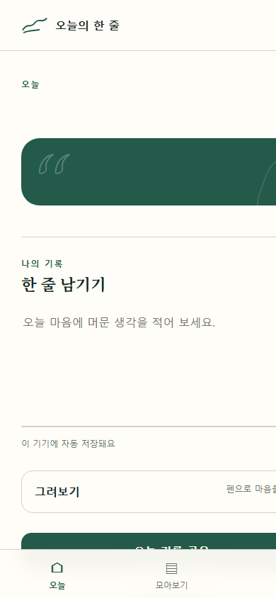

# 오늘의 한 줄

하루에 하나의 짧은 문장을 읽고, 떠오른 생각을 글과 그림으로 남기는 모바일 우선 개인 기록 웹앱입니다. 계정이나 서버 없이 브라우저 안에 기록을 보관하며, 정적 호스팅 환경에서 바로 배포할 수 있습니다.

## 이번 작업의 주요 내용

- 로컬 날짜를 기준으로 오늘의 문장을 결정하고, 같은 날짜에는 동일한 문장을 유지하도록 구현했습니다.
- 메모를 입력하면 약 500ms 후 IndexedDB에 자동 저장하고 재접속 시 복원합니다.
- 터치·마우스·펜을 지원하는 캔버스 드로잉, 한 획 취소, 전체 지우기를 구현했습니다.
- 저장된 기록의 날짜순 조회, 문장·메모 검색, 즐겨찾기 필터를 지원합니다.
- 문장별 즐겨찾기를 IndexedDB에 저장하여 재접속 후에도 유지합니다.
- 기기 설정, 밝음, 어두움, 초록 테마를 제공하며 선택값을 저장합니다.
- JSON 백업 내보내기와 스키마 검증, 중복 건수 미리보기, 병합·덮어쓰기 복원을 구현했습니다.
- 문장, 메모, 그림을 PNG 카드로 만들고 Web Share API 지원 환경에서는 공유할 수 있습니다.
- 서비스 워커와 웹 앱 매니페스트를 추가하여 정적 자산의 오프라인 재방문을 지원합니다.
- 키보드 포커스, 스크린 리더용 레이블, 충분한 터치 영역, 모션 감소 설정 등 접근성을 반영했습니다.
- 영화 대사 후보는 권리 검토 전 노출되지 않도록 별도 데이터 파일에서 `enabled: false`로 관리합니다.

## 오류 수정 사항

- 즐겨찾기 조회 후 같은 IndexedDB 트랜잭션을 재사용할 때 발생할 수 있는 `TransactionInactiveError`를 방지하도록 읽기와 쓰기 트랜잭션을 분리했습니다.
- 앱을 자정 이후 다시 활성화했을 때 이전 날짜를 계속 표시할 수 있던 조건을 수정하여, 오늘 화면에서만 새 날짜의 문장으로 안전하게 전환하도록 했습니다.
- 화면을 전환하거나 페이지를 닫기 전에 대기 중인 자동 저장을 완료하도록 처리했습니다.
- JSON 복원 전에 파일 크기, 스키마 버전, 날짜 형식, 문자열 길이, 획과 좌표 범위를 검증하도록 보강했습니다.
- 복원 작업을 하나의 트랜잭션에서 처리하여 오류 발생 시 기존 데이터를 보존하도록 했습니다.
- 문장과 메모를 DOM에 표시할 때 `textContent`를 사용하여 HTML 삽입을 방지했습니다.
- 캔버스 좌표를 0–1 범위로 정규화하여 화면 회전과 크기 변경 후에도 그림이 유지되도록 했습니다.

## 프로젝트 구조

```text
index.html
manifest.webmanifest
service-worker.js
assets/
data/
  quotes.original.json
  quotes.film-review.json
styles/
  tokens.css
  app.css
src/
  main.js
  quotes.js
  storage.js
  drawing.js
  backup.js
  share.js
```

## 로컬 실행

별도의 빌드 과정이나 외부 패키지가 필요하지 않습니다. ES Modules와 서비스 워커 제약 때문에 `file://`로 직접 열지 말고 로컬 HTTP 서버를 사용하세요.

```bash
python -m http.server 4173
```

브라우저에서 <http://127.0.0.1:4173>으로 접속합니다.

## 데이터와 개인정보

- 메모, 그림, 문장 배정, 즐겨찾기는 브라우저의 IndexedDB에 저장됩니다.
- 테마 설정만 `localStorage`에 저장됩니다.
- 로그인, 원격 분석, 광고 추적, 서버 전송 기능은 없습니다.
- 브라우저 데이터를 삭제하거나 다른 기기를 사용하면 기록이 자동으로 이동하지 않으므로 설정 화면에서 JSON 백업을 만들어 두는 것을 권장합니다.

## 검증 결과

- 전체 JavaScript 파일의 문법 검사를 통과했습니다.
- 날짜 키 생성, 날짜별 문장 결정, 연속 문장 방지, 배포 문장 검증, 백업 정상·오류 입력에 대한 로직 테스트 7개를 통과했습니다.
- Chrome에서 HTML, CSS, ES 모듈, 문장 데이터, 아이콘, 매니페스트가 정상적으로 요청되는 것을 확인했습니다.
- 모바일 기준 390×844 화면 크기로 렌더링을 확인했습니다.

## 배포

정적 파일만으로 구성되어 GitHub Pages, Netlify, Vercel Static 등 HTTPS 정적 호스팅에 배포할 수 있습니다. 하위 경로에 배포해도 동작하도록 앱 내부 자산 경로와 PWA 범위를 상대 경로로 구성했습니다.
